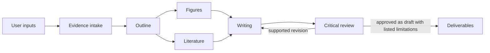

# Architecture

## System boundary

Research Paper Orchestra is a **ChatGPT-native agent orchestration skill**. Its architecture defines stage prompts, evidence contracts, artifact handoffs, and reviewer gates. It **does not** run a remote API service or five isolated concurrent LLM processes. Available ChatGPT tools provide file reading, research, code execution and file export as applicable.

## Workflow

### Responsibilities and handoffs

| Stage | Inputs | Gate | Artifact |
| --- | --- | --- | --- |
| Evidence intake | idea, logs, source manuscripts, venue | provenance of empirical claims | evidence ledger |
| Outline | hypothesis and ledger | contribution/claim-evidence alignment | structured outline |
| Plotting | real result tables | units, error bars, sample sizes, reproducibility | plot code and charts |
| Literature | scholarly sources | bibliographic + claim support verification | citation ledger, BibTeX |
| Writing | outline, figures, verified sources | no novel unsupported claims | section drafts, LaTeX |
| Reviewing | draft + provenance | methods, baselines, citations, ethics and style | review report + targeted revision |

## State model

`intake → outline → figures/citations → draft → review → release`

A stage is complete **only if its output exists and is inspected**. Plotting and literature may be independent but feed the same writer. Reviewer suggestions do not become facts automatically.

## Extensibility

The instructions live in `skills/research-paper-orchestra/SKILL.md`; detailed responsibilities and constraints live under its `references/` folder. The `plugin.json` file exposes the package in ChatGPT. A future external runtime could provide job queues, provider adapters, citation APIs, LaTeX compilation, persistent runs, and document storage, but none is deployed by this repository.

## Failure behavior

- No results data: give a figure plan rather than manufactured visualizations.
- No verification access: label citations provisional.
- Template unavailable: make venue-neutral draft and report missing formatting.
- Compilation unavailable: deliver source without claiming a PDF.
- Scientific blocker: return an explicit blocker, not a fake ready-to-submit label.
